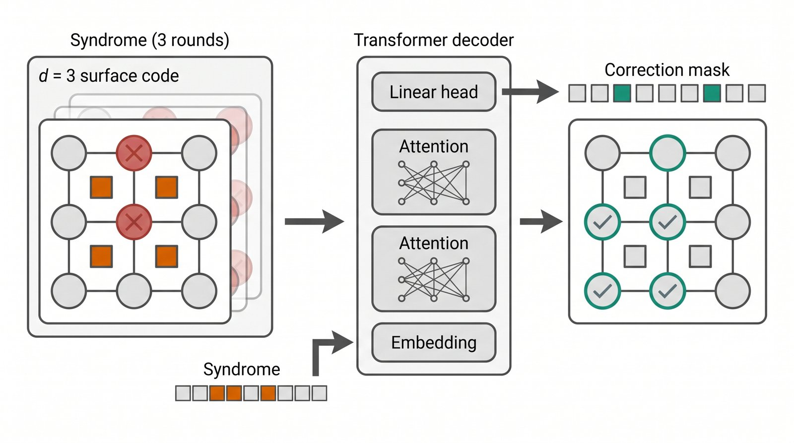
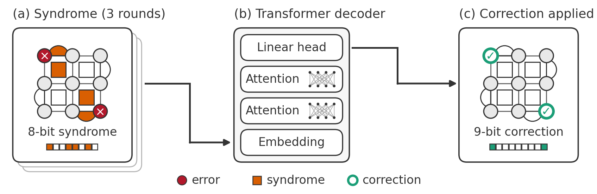

> 실험이 끝나고 표를 정리할 때까지는 괜찮은데, 그 결과를 한 장의 그림으로 압축해 보여줘야 할 때 막막해지곤 합니다. 이 글은 그 과정을 조금 수월하게 처리하기 위해 제가 쓰고 있는 파이프라인과, 생성형 AI를 쓰면서 지키고 있는 기준을 정리한 기록입니다.

---

## 1. 실험은 끝났는데, 그림이 따라오지 않을 때

연구를 하다 보면 실험과 시각화 사이의 불균형을 자주 느낍니다. 몇 주 동안 실험을 설계하고, 노이즈 모델을 바꿔가며 수백 번 돌리고, 수치를 검증하는 데는 시간을 아끼지 않습니다. 그런데 정작 그 결과를 보여주는 그림은 마감 직전에 기본 설정 그대로 뽑아낸 플롯인 경우가 많습니다.

축 라벨은 작아서 인쇄하면 잘 읽히지 않고, 개념도는 파워포인트 도형을 이어 붙인 티가 나며, 정작 하고 싶은 말은 캡션 세 줄에 숨어 있습니다. 탑티어 학회 논문들을 보면 한 장의 그림이 캡션 없이도 핵심 주장을 전달하는데, 그 차이가 실험의 질보다 표현 방식에서 오는 경우가 생각보다 많습니다.

저도 이 부분이 늘 아쉬워서 그림을 만드는 과정을 하나의 파이프라인으로 정리했고, 그 안에 생성형 AI를 일부 도입했습니다. 다만 AI가 개입하는 위치는 명확하게 제한했습니다.

## 2. 생성형 AI가 그린 그림을 그대로 쓸 수 없는 이유

요즘 이미지 생성 모델은 꽤 그럴듯한 과학 일러스트를 그려냅니다. "이 실험 결과를 깔끔한 그래프로 그려줘"라고 하면 보기 좋은 이미지가 바로 나옵니다. 하지만 연구자에게 이건 논문에 쓸 수 없는 그림입니다. **생성 모델이 그린 숫자와 곡선은 실제 데이터에서 계산된 것이 아니기 때문입니다.** 아무리 깔끔해 보여도 실험 결과를 담는 그림에 데이터와 무관하게 생성된 요소가 들어가면, 그것은 시각화가 아니라 왜곡에 가까워집니다.

그래서 기준을 단순하게 잡았습니다.

| 역할 | 담당 | 이유 |
|---|---|---|
| 배치, 구도, 시각적 표현 탐색 | **생성형 AI** (시안) | 빈 화면에서 구도를 고민하는 시간을 줄여 줌 |
| 그림에 들어가는 모든 수치와 의미 | **코드** (matplotlib / TikZ) | 데이터에서 직접 계산되어야 재현과 검증이 가능함 |
| 최종 판단 및 교차 확인 | **연구자** | 라벨의 의미와 수치 일치 여부는 사람이 직접 대조해야 함 |

AI는 구도를 잡는 초안 용도로만 쓰고, 실제 그림은 전부 코드가 그립니다.

## 3. 파이프라인 한눈에 보기

저는 이 과정을 Claude Code의 스킬로 묶어 두고, 피규어를 만들 때마다 동일한 순서를 밟습니다. 사용하는 도구는 아래와 같습니다.

| 구분 | 도구 | 비고 |
|---|---|---|
| 레이아웃 시안 | Nano Banana (Gemini 이미지 모델) | 이번 예시는 `gemini-3-pro-image-preview`로 생성 |
| MCP 서버 | [shinpr/mcp-image](https://github.com/shinpr/mcp-image) | Claude Code에서 이미지 모델을 호출하는 MCP 서버 (MIT 라이선스, `npx -y mcp-image`로 실행) |
| Figure 빌드 | matplotlib, TikZ | 데이터 플롯은 matplotlib, 개념도는 TikZ |
| 문서 조판 | LaTeX | 빌드된 PDF를 `\includegraphics`로 삽입 |
| 오케스트레이션 | Claude Code 스킬 | 시안 생성부터 검증까지 단계를 고정 |

단계별 흐름은 다음과 같습니다.

| 단계 | 하는 일 | 핵심 체크포인트 |
|---|---|---|
| 0. 질문 정의 | 이 그림이 답할 질문을 한 문장으로 정리 | 그림이 전달할 핵심 메시지 고정 |
| 1. 진단 | 기존 그림의 정보 밀도, 폰트, 라벨 의미 점검 | 캡션에만 적힌 주요 조건을 그림 안으로 이동 |
| 2. 시안 생성 | Nano Banana로 배치가 다른 시안 2~3개 생성 | 전체 레이아웃과 구도만 참고, 내부 텍스트와 수치는 무시 |
| 3. 코드 빌드 | 데이터 플롯은 matplotlib, 개념도는 TikZ로 작성 | 모든 색상과 수치는 원본 데이터 파일에서 직접 계산 |
| 4. 시각 검증 | 렌더링된 PNG를 열어 라벨, 수치, 겹침, 폰트 확인 | 컴파일 성공 여부와 별개로 눈으로 직접 결함 확인 |
| 5. 캡션 작성 | 첫 문장에 그림의 핵심 결론을 굵게 요약 | 그림 안에 다 넣지 못한 실험 조건만 캡션에 보충 |

이번 글에서는 제 연구 주제인 **표면 부호(surface code) 양자 오류 정정 디코더**의 개념도를 예시로 이 과정을 처음부터 끝까지 돌려 보겠습니다. 그림이 답해야 할 질문은 아래와 같이 정했습니다.

> *"학습된 Transformer 디코더는 거리 3 표면 부호의 신드롬 측정값을 어떻게 큐비트 보정값으로 바꾸는가?"*

## 4. 시안 생성: 구도는 참고하되 세부 의미는 걸러내기

프롬프트는 그때그때 즉흥적으로 쓰지 않고 정해둔 템플릿을 채워서 씁니다. 역할, 핵심 질문, 레이아웃, 패널별 요소, 스타일 토큰, 금지 조건을 항목별로 명시해 두면 비슷한 톤의 시안을 일관되게 얻을 수 있습니다.

```text
[ROLE]     Scientific figure designer for a top-tier ML venue (NeurIPS/ICLR).
[QUESTION] How does a learned Transformer decoder turn noisy stabilizer
           measurements on a distance-3 surface code into a qubit correction?
[LAYOUT]   Three panels left-to-right connected by bold arrows:
           (1) lattice with errors and syndromes, (2) decoder, (3) corrected lattice.
[ELEMENTS] Panel 1: 3x3 data qubits, 8 stabilizers, two errors, three syndromes ...
[STYLE]    Flat vector, white background, thin #333 outlines,
           colorblind-safe palette (teal #1b9e77, orange #d95f02) ...
[FORBID]   No photorealism, no 3D, no gradients, no tiny unreadable text ...
```

레이아웃 조건만 바꿔 시안을 두 개 뽑았습니다. 아래는 그중 좌우 3패널 구성입니다.

{fig-align="center" width="85%"}

얼핏 보면 구도도 깔끔하고 색상도 절제되어 있어 그럴듯해 보입니다. 하지만 도메인 지식을 기준으로 하나씩 대조해 보면 맞지 않는 부분이 바로 드러납니다.

- 발생한 오류는 **2개**인데, 보정된 큐비트는 **5개**로 표시되어 있습니다.
- 출력 마스크에는 보정이 2칸만 칠해져 있는데, 오른쪽 격자에는 5개가 표시되어 앞뒤가 맞지 않습니다.
- 신드롬 벡터가 실제 안정자 개수인 8칸이 아니라 **9칸**으로 그려져 있습니다.

다른 레이아웃의 시안 역시 격자 자체가 거리 3 구조가 아니었고, 오류 위치와 보정 위치가 어긋나 있었습니다. 어느 쪽도 그대로 논문에 쓸 수 없는 그림입니다. 생성 모델은 시각적으로 그럴듯한 형태를 만들 뿐, 물리적 의미나 수학적 정합성까지 보장하지는 않기 때문입니다.

따라서 시안에서는 코드로 구현할 때 참고할 시각적 아이디어만 추려냅니다.

- 좌에서 우로 이어지는 3패널 흐름과, 반복 측정 라운드를 겹친 카드로 표현한 구도
- 디코더 내부를 아래에서 위로 쌓인 레이어 블록으로 도식화한 방식
- 입출력을 1차원 비트 띠로 보여주는 표현과, 다른 시안의 색상 범례 구성

## 5. 코드 빌드: 데이터에서 직접 계산해 그리기

이제 추려낸 구도를 바탕으로 코드로 다시 그립니다. 핵심은 손으로 직접 색칠하지 않는 것입니다. 각 안정자가 어떤 큐비트를 검사하는지, 몇 번 큐비트에 오류가 발생했는지만 JSON 파일에 정의하고, 실제로 어떤 안정자에 불이 켜지는지는 스크립트가 패리티(parity) 연산으로 계산하게 합니다.

```json
{
  "stabilizers": [
    {"name": "B00", "kind": "bulk",     "support": [0, 1, 3, 4]},
    {"name": "T",   "kind": "boundary", "support": [0, 1], "side": "top"},
    "..."
  ],
  "errors": [0, 8],
  "rounds": 3
}
```

```python
errors = set(DATA["errors"])      # JSON의 리스트를 집합으로 읽어 둠
correction = set(errors)          # 개념 예시: 복호가 성공했다고 가정

def parity(stab, flips):
    return sum(q in flips for q in stab["support"]) % 2

syndrome = [parity(s, errors) for s in STABS]               # 켜지는 안정자 계산
residual = [parity(s, errors ^ correction) for s in STABS]  # 보정 후 잔여 신드롬
assert len(syndrome) == 8 and sum(residual) == 0            # 보정 후 잔여 신드롬이 0인지 검증
```

이렇게 구성해 두면 예시 오류 위치를 바꾸더라도 신드롬, 비트 띠, 보정 큐비트 표시가 함께 바뀝니다. 그림의 일부만 수동으로 고치다가 앞뒤가 안 맞게 되는 실수가 생기지 않습니다. 마지막 `assert` 구문은 "보정 후 모든 안정자가 만족된다"는 조건이 깨지면 그림이 아예 저장되지 않도록 막는 안전장치입니다.

그림 크기도 처음부터 학회 인쇄 폭에 맞춥니다. NeurIPS나 ICLR의 단일 컬럼(1단) 본문 폭인 5.5인치로 캔버스를 잡고 폰트를 8pt 이상으로 고정하면, LaTeX에 `width=\linewidth`로 넣었을 때 1:1 비율로 들어가 글씨가 작아지지 않습니다. 피규어 글씨가 작아 읽히지 않는 문제는 대부분 큰 캔버스에 그린 뒤 본문 폭에 맞춰 축소할 때 생깁니다.

## 6. 검증: 렌더를 직접 봐야 보이는 것들

스크립트가 에러 없이 실행됐다고 끝은 아닙니다. 렌더링된 PNG 파일을 직접 열어 눈으로 확인해야 합니다. 이번 작업에서도 첫 렌더링 결과물에는 시각적 결함이 있었습니다. 데이터의 의미는 다 맞았지만, 레이어 이름이 어텐션 도식과 겹치고, 패널 하단 설명이 테두리 밖으로 삐져나왔으며, 범례 텍스트가 옆 아이콘에 바짝 붙어 있었습니다. 모두 코드 실행 단계에서는 에러로 잡히지 않는 문제들입니다.

화살표 위에 있던 비트 띠를 패널 안쪽으로 옮겨 아예 겹치지 않게 하고, 화살표 모서리의 미세한 끊김까지 수정해 최종본을 완성했습니다.

{fig-align="center" width="100%"}

초기 AI 시안과 나란히 놓고 보면 전체적인 배치는 가져왔지만, 최종본에서는 **오류 2개 → 켜진 안정자 4개 → 8비트 신드롬 → 9비트 보정 마스크 → 잔여 신드롬 0**까지 모든 수치가 맞아떨어집니다. 그림 안에 비트 수와 범례를 직접 배치해 캡션을 길게 읽지 않아도 흐름을 파악할 수 있게 했습니다.

## 7. LaTeX에 넣고, 계속 유지보수하기

빌드 스크립트는 논문 삽입용 벡터 파일(PDF)과 시각 검증용 이미지(PNG)를 동시에 출력합니다. LaTeX 문서에는 아래처럼 불러오기만 하면 됩니다.

```latex
\begin{figure}[t]
  \centering
  \includegraphics[width=\linewidth]{figs/qec_decoder_concept.pdf}
  \caption{\textbf{A learned decoder maps an 8-bit syndrome to a 9-bit correction.}
           (a) Two errors trigger four stabilizers. (b) ... (c) ...}
\end{figure}
```

이 방식을 계속 쓰는 가장 큰 이유는 유지보수가 편하기 때문입니다. 리뷰어가 다른 오류 패턴에 대한 예시를 요청하면 JSON 파일에서 `errors` 한 줄만 고치고 스크립트를 다시 실행하면 됩니다. 목표 학회가 바뀌어 색상 톤을 조정해야 할 때도 팔레트 딕셔너리만 수정하면 일괄 반영됩니다. 피규어가 데이터와 코드로 남아 있으니 몇 달 뒤의 저나 공동 저자도 같은 그림을 다시 만들 수 있습니다. 파워포인트나 일러스트레이터로 직접 그린 그림은 이런 식의 관리가 어렵습니다.

## 8. 마치며

생성형 AI를 연구에 활용하는 방법은 다양하지만, 적어도 논문 피규어를 만들 때는 역할 분담이 명확해야 한다고 생각합니다. AI가 잘하는 일은 빈 화면 앞에서 "어떻게 배치할까?"를 고민하는 초기 탐색 시간을 줄여 주는 것이고, 못하는 일은 데이터와 수식의 정합성을 끝까지 지키는 것입니다. 그렇다면 구도와 표현 아이디어는 AI에게서 얻고, 정확성과 재현성은 코드로 보장하면 됩니다.

이번 예시 그림 하나를 만드는 동안에도 AI 시안에서 의미 오류 3가지를 걸러냈고, 첫 코드 렌더링에서 레이아웃 겹침 3가지를 수정했습니다. 어느 것도 자동으로 해결되지 않았고, 결국 사람이 직접 눈으로 대조하며 잡아야 했습니다. 도구가 아무리 발전해도 파이프라인의 마지막 단계는 연구자의 직접 검토여야 하는 이유입니다.

::: {.callout-tip title="요약"}
- 생성형 AI는 초기 배치와 구도 시안을 잡는 용도로만 쓰고, 실제 그림 속 수치와 요소는 데이터에서 계산하는 코드로 그립니다.
- 프롬프트는 템플릿화하고, 그림은 학회 인쇄 폭과 8pt 이상 폰트 기준으로 작성하며, 결과물은 PDF + 스크립트 + 데이터 형태로 남겨 유지보수합니다.
- 코드가 에러 없이 실행된 후에도 렌더링된 이미지를 직접 열어 텍스트 겹침과 수치 일치 여부를 검토합니다.
:::

::: {.callout-important title="연구 윤리 및 사용 범위에 관한 고지"}
본 글에서 다루는 생성형 AI 활용은 **연구 결과를 생성하거나 대체하기 위한 것이 아니라**, 이미 확보하고 검증한 연구 내용을 보다 명료하게 전달하기 위한 **시각화와 발표 효율 향상 도구**로서의 활용입니다.

- 그림에 표시되는 모든 수치와 의미는 연구자가 직접 확보한 데이터와 정의로부터 **코드로 계산**되며, 생성형 AI는 배치와 구도의 **시안**에만 관여합니다.
- 생성형 AI가 제안한 시안, 코드, 문구는 최종 반영 전에 반드시 **연구자의 검토와 검증**을 거치며, 그 결과물에 대한 책임은 전적으로 **저자**에게 있습니다.
- 학술지나 학회에 투고할 때에는 해당 기관의 생성형 AI 활용 정책을 확인하고, 요구되는 경우 사용 사실을 명시해야 합니다.

본문의 예시 그림은 개념 설명용이며, 실제 실험 결과를 나타내지 않습니다.
:::
